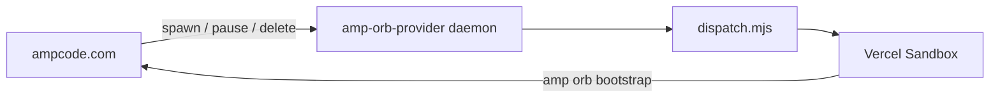

# Amp orbs on Vercel

Run [Amp self-hosted orbs](https://ampcode.com/docs/orbs/self-hosted) on [Vercel Sandbox](https://vercel.com/docs/sandbox), with Amp's orb provider running as a [Vercel Daemon](https://vercel.com/docs/daemons). Each Amp thread gets its own persistent sandbox. The provider authenticates to Vercel with the daemon's [OIDC token](https://vercel.com/docs/oidc), so you don't store a Vercel access token, and you don't need Docker.

> [!NOTE]
> Vercel Daemons are in Public Beta.

## How it works

The following diagram shows how a thread gets an orb:



The project declares two daemons in `vercel.json`:

| Daemon | Instances | Purpose |
| --- | --- | --- |
| `amp-orb-provider` | 1 | Runs `amp orb provider`, which receives jobs from Amp and runs `provider/dispatch.mjs` for each one. |
| `orb-image` | 0 | Never runs. Each deployment builds it from Amp's orb image and pushes it to Vercel Container Registry (VCR) as `daemon.orb-image`. |

For each job, `dispatch.mjs` does the following:

- `spawn` creates or resumes a persistent sandbox named after the orb, then starts `amp orb bootstrap` inside it. A new orb boots from the newest image in `daemon.orb-image`.
- `pause` stops the sandbox. Vercel keeps the files but not the memory.
- `delete` stops the sandbox, deletes its snapshots, and deletes the sandbox.

Orbs use 4 vCPUs and 8 GB of memory, and stop after one hour at most. A paused orb's snapshot expires 30 days after its last pause.

## Set up

You need an Amp workspace where you can add an orb provider, a Vercel account with Sandbox access, and the [Vercel CLI](https://vercel.com/docs/cli).

1. Clone this repository and link it to a new Vercel project:

   ```sh
   vercel link
   ```

2. In your Amp workspace, open **Settings** > **Orbs** and click **Add Orb Provider**.
3. Copy the `aop_live_…` token. Amp shows it only once.
4. Store the token as a sensitive Production environment variable. The CLI prompts for the value:

   ```sh
   vercel env add AMP_ORB_PROVIDER_TOKEN production --sensitive
   ```

5. Deploy to production. Daemons run only in production:

   ```sh
   vercel --prod
   ```

6. In Amp, start a thread, click **Orb**, and choose your provider under **Self-Hosted**.

Run one provider per Amp provider token.

## Credentials

| Credential | Lifetime | Where it's stored |
| --- | --- | --- |
| Vercel OIDC token | Short-lived. Vercel refreshes it for the daemon. | Nowhere. The SDK reads it from the daemon's token file for each job. |
| Amp provider token | Long-lived, until you delete the provider in Amp | A sensitive environment variable |

## Update Amp's orb image

Each production deployment rebuilds `daemon.orb-image` from Amp's latest image. New orbs use the newest build; existing orbs keep the image they started from. To pick up a new Amp image, redeploy:

```sh
vercel --prod
```

## Costs

The provider daemon is billed for Active CPU and Provisioned Memory (1 GiB) while it runs. Orbs are billed as Vercel Sandbox usage: Provisioned Memory while they run, and Snapshot Storage while they're paused. See [Sandbox pricing](https://vercel.com/docs/sandbox/pricing) and [Daemons limits](https://vercel.com/docs/daemons/limits).

To stop all charges:

1. Set the `amp-orb-provider` instance count to `0` in `vercel.json`, and redeploy.
2. Remove the remaining sandboxes and their snapshots:

   ```sh
   vercel sandbox list
   vercel sandbox remove <sandbox-name> --delete-orphan-snapshots
   vercel sandbox snapshots list
   ```

## Test the dispatch program locally

`dispatch.mjs` authenticates only with OIDC. To run it on your computer, pull the project's development OIDC token, which expires after 12 hours:

```sh
vercel env pull
cd provider
npm install
export ORB_ID=amp-dispatch-test-$(date +%s) ORB_TOKEN=fake
for op in spawn spawn pause delete delete; do ORB_OPERATION=$op node --env-file=../.env.local dispatch.mjs; done
```

Deploy the project once first, so `daemon.orb-image` exists. The fake `ORB_TOKEN` can't connect to Amp, but the run checks sandbox creation, resume, pause, and cleanup.

## Troubleshoot

- **`Could not get credentials from OIDC context`:** The dispatch program has no OIDC token. It runs on the daemon, or locally after `vercel env pull`.

- **`No ready image in daemon.orb-image`:** Deploy the project to production to build the image.
- **The thread waits at "Creating orb":** Check the `amp-orb-provider` daemon logs in the Vercel dashboard. Make sure no other provider uses the same token.
- **Environment variable changes have no effect:** Daemons receive environment variables at deployment. Redeploy to production.
