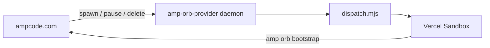

# Amp orbs on Vercel

<picture>
  <source media="(prefers-color-scheme: dark)" srcset=".github/assets/preview-dark.png">
  
</picture>

Run [Amp self-hosted orbs](https://ampcode.com/docs/orbs/self-hosted) on [Vercel Sandbox](https://vercel.com/docs/sandbox), with Amp's orb provider running as a [Vercel Daemon](https://vercel.com/docs/daemons). Each Amp thread gets its own persistent sandbox. The provider authenticates to Vercel with the daemon's [OIDC token](https://vercel.com/docs/oidc), so you don't store a Vercel access token, and you don't need Docker.

> [!NOTE]
> Vercel Daemons are in Public Beta.

## Quick start

You need an Amp workspace where you can add an orb provider, and a Vercel account with Sandbox access.

1. In your Amp workspace, open **Settings** > **Orbs**, click **Add Orb Provider**, and copy the `aop_live_…` token. Amp shows it only once.
2. Click **Deploy** and paste the token when Vercel asks for `AMP_ORB_PROVIDER_TOKEN`:

   [](https://vercel.com/new/clone?repository-url=https%3A%2F%2Fgithub.com%2Fatinux%2Famp-orbs-on-vercel&project-name=amp-orbs-on-vercel&repository-name=amp-orbs-on-vercel&env=AMP_ORB_PROVIDER_TOKEN&envDescription=The%20aop_live_%20token%20of%20a%20custom%20orb%20provider.%20Create%20one%20in%20your%20Amp%20workspace%20settings%20under%20Orbs.&envLink=https%3A%2F%2Fampcode.com%2Fworkspace%23custom-orb-providers)

3. When the deployment is ready, start a thread in Amp, click **Orb**, and choose your provider under **Self-Hosted**.

The first deployment takes a few minutes, because it copies Amp's orb image. Run one provider per Amp provider token.

## How it works

The following diagram shows how a thread gets an orb:



The project declares two daemons in `vercel.json`:

| Daemon | Instances | Purpose |
| --- | --- | --- |
| `amp-orb-provider` | 1 | Runs `amp orb provider`, which receives jobs from Amp and runs `provider/dispatch.mjs` for each one. |
| `orb-image` | 0 | Never runs. Each deployment builds it from Amp's orb image and pushes it to Vercel Container Registry (VCR) as `daemon.orb-image`. |

For each job, `dispatch.mjs` does the following:

- `spawn` creates or resumes a persistent sandbox named after the orb, then starts `amp orb bootstrap` inside it. A new orb boots from the newest image in `daemon.orb-image`.
- `pause` stops the sandbox. Vercel keeps the files but not the memory.
- `delete` stops the sandbox, deletes its snapshots, and deletes the sandbox.

Orbs use 4 vCPUs and 8 GB of memory, and stop after one hour at most. A paused orb's snapshot expires 30 days after its last pause.

## Deploy with the CLI

To deploy from your own clone instead of the Deploy button, use the [Vercel CLI](https://vercel.com/docs/cli). This also lets you store the token as a sensitive environment variable.

1. Clone this repository and link it to a new Vercel project:

   ```sh
   vercel link
   ```

2. In your Amp workspace, open **Settings** > **Orbs** and click **Add Orb Provider**.
3. Copy the `aop_live_…` token. Amp shows it only once.
4. Store the token as a sensitive Production environment variable. The CLI prompts for the value:

   ```sh
   vercel env add AMP_ORB_PROVIDER_TOKEN production --sensitive
   ```

5. Deploy to production. Daemons run only in production:

   ```sh
   vercel --prod
   ```

6. In Amp, start a thread, click **Orb**, and choose your provider under **Self-Hosted**.

## Credentials

| Credential | Lifetime | Where it's stored |
| --- | --- | --- |
| Vercel OIDC token | Short-lived. Vercel refreshes it for the daemon. | Nowhere. The SDK reads it from the daemon's token file for each job. |
| Amp provider token | Long-lived, until you delete the provider in Amp | A sensitive environment variable |

## Pinned dependencies

The provider daemon can obtain the project's OIDC tokens, so its image only runs code pinned in `provider/package-lock.json`:

- The Amp CLI comes from npm (`@ampcode/cli`) at an exact version, not from a remote install script. Its platform binaries are optional dependencies with integrity hashes in the lockfile.
- The Sandbox and OIDC SDKs are pinned to exact versions. An npm override pins `zod` to a release that fixes [GHSA-mrhx-c7xc-m3w5](https://github.com/advisories/GHSA-mrhx-c7xc-m3w5).
- The Docker build runs `npm ci --ignore-scripts`, so no package script runs until npm has verified every package. Amp's setup script then places the binary, and `amp --version` fails the build if the binary is missing.
- `AMP_SKIP_UPDATE_CHECK=1` stops the CLI from updating itself at runtime.

## Orb tools

The orb image adds pinned `agent-browser@0.41.2` and [Lightpanda 1.0.3](https://github.com/lightpanda-io/browser/releases/tag/1.0.3) to Amp's base image. Chrome, `gh`, `jq`, and `ffmpeg` come from the base. No custom skills, personal instructions, plugins, or configuration are included. The provider image is unchanged.

Lightpanda is the default engine (`AGENT_BROWSER_ENGINE=lightpanda`) for supported browsing, research, and DOM interaction:

```sh
agent-browser --session research open http://localhost:3000
agent-browser --session research snapshot
agent-browser --session research close
```

Use Chrome only when the task needs full-fidelity CSS/layout or canvas rendering, visual screenshots, video, persistent profiles, extensions, or encounters a real Lightpanda compatibility failure. Start directly with Chrome when the requirement is known to be unsupported by Lightpanda; an unsuccessful attempt adds no useful evidence. Use a fresh, named session with an explicit override:

```sh
agent-browser --session visual-review --engine chrome open http://localhost:3000
agent-browser --session visual-review --engine chrome screenshot /tmp/visual-review.png
agent-browser --session visual-review --engine chrome close
```

Lightpanda 1.0.3 produces text-only PNG/PDF output, not full visual rendering: its PNGs are not UI proof. Its telemetry is disabled. The image downloads the stable Linux amd64 release and verifies its SHA-256 before installation; it does not use nightly builds or remote install scripts.

For before/after PR evidence, capture screenshots and recordings with `agent-browser` using Chrome, then use GitHub CLI 2.99+ and its native `--attach` support for approved uploads. The optional official public [before-and-after agent skill](https://github.com/vercel-labs/before-and-after) formats existing media and manages a marked block in the PR description. Install it separately if wanted; this starter does not bundle skills or personal workflows. Installing tools or skills grants no credentials or permission to publish.

To install and audit the tool package locally:

```sh
cd orb-image
npm ci --ignore-scripts
npm audit --omit=dev
```

During image builds, the task user runs `agent-browser --version` and `lightpanda version` to check that the installed executables start. These checks do not launch browsers or prove browser functionality; full browser validation can be run separately in CI or manually.

Update exact npm pins and the lockfile together with `npm install --save-exact --ignore-scripts`; review integrity changes and the audit before redeploying.

## Update Amp's orb image

Each production deployment rebuilds `daemon.orb-image` from Amp's latest image. New orbs use the newest build; existing orbs keep the image they started from. To pick up a new Amp image, redeploy:

```sh
vercel --prod
```

## Update the Amp CLI and SDKs

The provider keeps the pinned versions until you change them. To upgrade, review the new release, then update the exact pin and the lockfile together:

```sh
cd provider
npm install --save-exact @ampcode/cli@<approved-version>
npm audit --omit=dev
```

Review the version and `integrity` changes in `package-lock.json`, commit `package.json` and `package-lock.json` together, and redeploy. Never regenerate the lockfile during the Docker build, and never replace an integrity hash to get past a mismatch; investigate it instead.

## Costs

The provider daemon is billed for Active CPU and Provisioned Memory (1 GiB) while it runs. Orbs are billed as Vercel Sandbox usage: Provisioned Memory while they run, and Snapshot Storage while they're paused. See [Sandbox pricing](https://vercel.com/docs/sandbox/pricing) and [Daemons limits](https://vercel.com/docs/daemons/limits).

To stop all charges:

1. Set the `amp-orb-provider` instance count to `0` in `vercel.json`, and redeploy.
2. Remove the remaining sandboxes and their snapshots:

   ```sh
   vercel sandbox list
   vercel sandbox remove <sandbox-name> --delete-orphan-snapshots
   vercel sandbox snapshots list
   ```

3. Delete both daemon image repositories, which keep billing for VCR storage. The next deployment builds them again:

   ```sh
   vercel vcr rm daemon.orb-image
   vercel vcr rm daemon.amp-orb-provider
   ```

## Test the dispatch program locally

`dispatch.mjs` authenticates only with OIDC. To run it on your computer, pull the project's development OIDC token, which expires after 12 hours:

```sh
vercel env pull
cd provider
npm ci --ignore-scripts
export ORB_ID=amp-dispatch-test-$(date +%s) ORB_TOKEN=fake
for op in spawn spawn pause delete delete; do ORB_OPERATION=$op node --env-file=../.env.local dispatch.mjs; done
```

Deploy the project once first, so `daemon.orb-image` exists. The fake `ORB_TOKEN` can't connect to Amp, but the run checks sandbox creation, resume, pause, and cleanup.

## Troubleshoot

- **`Could not get credentials from OIDC context`:** The dispatch program has no OIDC token. It runs on the daemon, or locally after `vercel env pull`.

- **`No ready image in daemon.orb-image`:** Deploy the project to production to build the image.
- **The thread waits at "Creating orb":** Check the `amp-orb-provider` daemon logs in the Vercel dashboard. Make sure no other provider uses the same token.
- **Environment variable changes have no effect:** Daemons receive environment variables at deployment. Redeploy to production.
